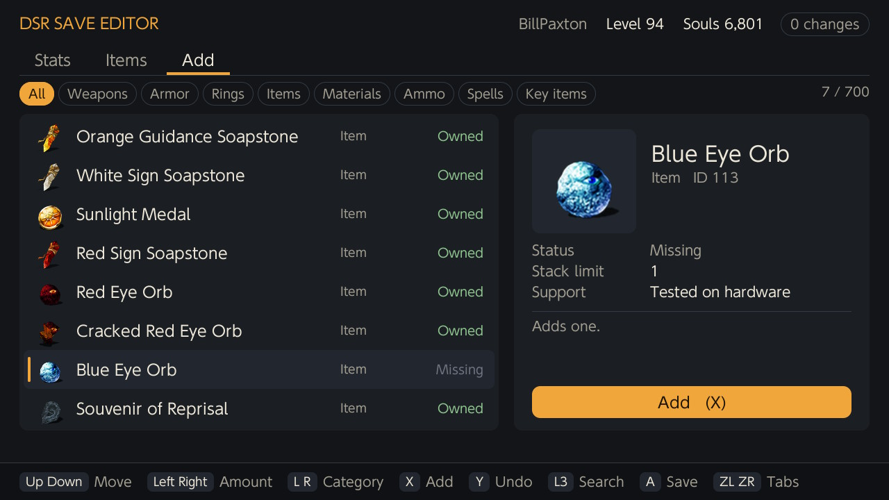

# DSR Save Editor

A save editor for **Dark Souls: Remastered** on the Nintendo Switch. It runs as homebrew straight from your console, reads the
game's own save data, lets you change your character and inventory in a proper on-screen interface, fixes the save's checksum
and writes it back, with a backup first every time.



## Features

- **Stats:** souls, level, the eight attributes, HP and stamina. Level follows your attributes automatically.
- **Items:** change the quantity of materials, Humanity and other stacks you already own.
- **Add:** put items into your inventory that you don't have yet: 217 goods (materials, consumables, spells, key items), 41 rings,
  232 armor pieces and 210 weapons and shields (including ammunition). Everything is the +0 version, with the game's own stack
  limits and durability.
- **Browse with ease:** category tabs, search by name, Owned / Missing / Staged status, and the game's item icons if you add them.
- **Several characters:** if the save holds more than one, you choose which to edit.
- **Safe by design:** a verified backup before every write, with read-back checks after. See [Safety](#safety).

## Installing

1. Download `DSRSaveEditor.nro` from the [Releases](../../releases) page.
2. Copy it to `sdmc:/switch/` on your SD card.
3. Close Dark Souls Remastered completely, then start the editor from the Homebrew Menu (title-takeover launch is fine).

## Using it

| Button | Action |
| --- | --- |
| ZL / ZR (or −) | Switch between Stats, Items and Add |
| Up / Down, left stick | Move. Hold to repeat, and it speeds up |
| Left / Right | Change the value by 1. Hold to speed up: 1, then 10, then 100 per step. On the Add screen: the amount to add |
| L / R | Stats: −1000 / +1000. Add screen: previous / next category |
| Right stick | Add screen: up/down scrolls a page at a time, left/right changes category |
| Left stick click | Add screen: search by name (system keyboard) |
| Right stick click | Add screen: show / hide the 8 cut armor pieces (see below) |
| X | Set to maximum (Stats and Items). Add screen: add the item (stackable items: the chosen amount) |
| Y | Revert (on the Add screen: undo an add) |
| A | Save: shows the list of changes and asks to confirm |
| B or + | Exit (asks if there are unsaved changes) |

On the Add screen, an item you already own says so, and equipment you own cannot be added twice. Stackable items start at an amount of 1.
Key items can skip story progress, so only add them if you know what they do. The unobtainable Elite Cleric and Mage Smith armor
is hidden by default: click the right stick on the Add screen to show those 8 pieces at the end of the list, and again to hide them.

### Item icons (optional)

The lists show the game's own item icons if they are in `sdmc:/switch/DSRSaveEditor/icons/` (files named like `40000000_106.png`).
Without them you get a plain box instead. The icons are the game's artwork, so they are not part of this project: you extract them
from your own copy of the game with the scripts in `tools/` (see the notes at the top of `tools/export_icons.py`).

## Safety

- **Checksum gate.** On load the app recomputes the save's MD5 and compares it to the stored one.
  If they differ (different game version, unknown layout), the file is shown **read-only** and nothing
  can be written.
- **Backup first, and never overwritten.** Before every write the editor checks that the save on the
  console is still the file it loaded, then copies the untouched original to
  `sdmc:/switch/DSRSaveEditor/backups/` under a name that includes your account and a timestamp. Two
  backups never share a name, and an existing backup is never replaced. The backup is read back and
  must match byte for byte before anything is written. If any of that fails, the save is not
  written and your edits stay on screen.
- **Failed saves are handled.** The file is overwritten in place at its original size, committed,
  read back and its checksum is verified for the character you edited. If a write, commit or
  verification fails, the editor stops offering to save again, tells you where your backup is, and
  asks you to restore it and restart. Only a verified save is treated as the new starting point.
- **Unrecognised saves are not opened for editing.** A matching checksum alone does not make an
  unknown layout safe, so a file with no recognised character is shown as unsupported.
- **Offline only.** Play with an edited save offline. Edited saves can get flagged online, and the
  risk is yours. Keep a backup of your clean save.

## What is and isn't covered

- Tested on a real Switch: stats, items, adding goods, rings, armor, weapons, ammunition and spells, the backup and save checks, and the screens.
- **Experimental:** key items and the hidden cut armor. The app labels them as such.
- Not offered: Estus Flask (upgrading it changes its item ID), gestures, unused entries, and upgraded or infused (+N) gear.
- Only items in the character's inventory are shown. The bottomless box is not read or changed.
- Value limits (for example stats 1-99 and HP up to 9999) are conservative guards chosen for this app, not limits taken from the game files.

For exactly what is written and why, see [docs/HOW_IT_WORKS.md](docs/HOW_IT_WORKS.md).

## Building from source

1. Install [devkitPro](https://devkitpro.org/wiki/Getting_Started) with the `switch-dev` group.
2. Install the graphics libraries: `sudo dkp-pacman -S switch-sdl2 switch-sdl2_ttf switch-sdl2_image switch-pkg-config`
   (on Windows use the MSYS2 shell that devkitPro installs, run `pacman -S ...` and drop `sudo`).
3. Set `DEVKITPRO` (for example `export DEVKITPRO=/opt/devkitpro`) and run `make`.
4. Copy `DSRSaveEditor.nro` to `sdmc:/switch/`.

If the link step reports missing SDL or freetype symbols, run
`$DEVKITPRO/portlibs/switch/bin/aarch64-none-elf-pkg-config --libs --static sdl2 SDL2_ttf SDL2_image`
and paste its output into `SDL_LIBS` in the Makefile.

## Tests

The save logic, the backup transaction, the Add list and the screen layout have no console dependencies and are tested on a PC:

```
make -C tests
```

This covers MD5 test vectors, edit and re-checksum round trips, tamper detection, malformed headers, fault injection in the save
transaction (failed backups, partial writes, stale files), hold-to-repeat timing, and the layout of every screen (nothing leaves the
1280x720 screen or overlaps other text, with the longest item names). `DSR_DUMP=<dir> make -C tests` writes the draw commands and
`python3 tools/render_dump.py <dir> <out>` turns them into PNGs. The Switch layer itself (`source/main.cpp`, `source/gfx_sdl.cpp`)
can only be checked on hardware.

## Project layout

```
include/   headers (save format, backup transaction, Add list, drawing interface, screens, input)
source/    main.cpp (flow, input, files), gfx_sdl.cpp (SDL drawing), ui.cpp (screens), catalog.cpp (Add list),
           save.cpp (format and edits), persist.cpp (backup and write), md5.cpp, generated item tables (*.inc)
tests/     host unit tests
docs/      how the editor works
research/  how the save format and item tables were worked out (scripts, CSVs, notes)
tools/     scripts to extract item icons from your own game dump, and to render the screens on a PC
```

## Credits

Save layout and offsets: Jojo's Dark Souls Remastered config/script in
[EdiZon_CheatsConfigsAndScripts](https://github.com/WerWolv/EdiZon_CheatsConfigsAndScripts). Built with
[devkitPro](https://devkitpro.org/), libnx and SDL2. Made by D-Barsh and Claude.

## Disclaimer

This is a fan-made tool and is not affiliated with or endorsed by FromSoftware, Bandai Namco or Nintendo. Dark Souls is a trademark of
its owners. The game's artwork is not included: the optional item icons are extracted by you from your own copy of the game.
**Use at your own risk.** Editing saves can corrupt them or get an account flagged online, so play offline with an edited save and keep a
backup of your clean save. The authors are not responsible for lost or damaged saves or for any action taken against an account.

Released under the MIT License (see `LICENSE`).
